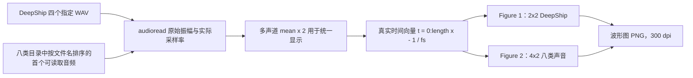

# 基于多尺度 Katz 分形维数的舰船声音分类研究

## Ship Sound Classification Based on Multiscale Katz Fractal Dimension

## 1. 项目介绍

本项目归档面向舰船水声信号分类的 MATLAB 实现：从固定长度的音频片段提取分形维数特征，并使用 KNN 完成片段级分类比较。当前研究主体为 **Katz Fractal Dimension**，包括单尺度 Katz 与多尺度 Katz 特征；CI-Higuchi、传统 Higuchi、FX（计盒维数）、Petrosian、Dubuc 和 R/S 等保留为对比算法或归档实现。现已建立 `v2` 与 `v3_ds` 的多算法分类性能对比与可视化入口，便于在统一样本、划分与 KNN 协议下核对算法差异。

仓库不含原始音频、提取特征或本次文档更新产生的实验输出。本 README 只陈述从当前代码与既有更新日志可核对的实现；本次未运行 MATLAB、Octave、音频读取、特征计算、训练或分类，故不据此新增任何性能结论。

## 2. 项目总体处理流程

主线多尺度 Katz 入口为 `v2/ci_fd_katz_multiscale10.m`。其代码对每个 2048 点原始片段独立执行尺度 `1:10` 的非重叠均值粗粒化，随后在每一尺度调用 `Katz_FD`，形成 10 维特征。尾部不足一个粗粒化组的采样点会舍弃。

```mermaid
flowchart TD
    A[舰船音频数据集] --> B[audioread；多声道 mean(x,2)]
    B --> C[每类前 200 个非重叠 2048 点片段]
    C --> D[每个片段独立进行 tau=1:10 非重叠均值粗粒化]
    D --> E[每个尺度计算 Katz Fractal Dimension]
    E --> F[各分形维数算法各自构建 10 维特征向量]
    F --> G[算法特征矩阵与类别标签]
    G --> H[固定随机种子序列：每类 100 个训练、100 个测试]
    H --> I[1-NN；欧氏距离]
    I --> J[重复实验准确率统计]
    J --> K[识别率柱状图：均值和标准差]
    F --> L[t-SNE 降至二维：仅作可视化]
    L --> M[t-SNE 综合散点图]
```

`v2/ci_fd_katz_multiscale10.m` 当前配置为 8 类，因此构建 `1600×10` 特征矩阵；`v3_ds/ds_katz.m` 为 4 类，对应 `800×10`。两者均以 2048 点为每个样本的信号长度，而“每类 200 个片段”是样本数量，二者不是同一概念。

## 3. Katz 分形维数算法

仓库的 Katz 实现位于 `对比算法/Katz_FD.m`，输入为行向量。对长度为 `N` 的序列，令 `n=N-1`；相邻点的平面距离之和为曲线总长度：

\[
L=\sum_{i=1}^{N-1}\sqrt{1+(x_i-x_{i+1})^2}。
\]

以首点到后续各点的最大平面距离作为直径：

\[
d=\max_{i=2,\ldots,N}\sqrt{(1-i)^2+(x_1-x_i)^2}。
\]

代码使用的 Katz 分形维数为：

\[
\mathrm{KFD}=\frac{\log_{10}(n)}{\log_{10}(n)+\log_{10}(d/L)}。
\]

该标量用于描述离散信号曲线的几何复杂度。单尺度入口在调用前将片段转换为行向量；多尺度入口对每个粗粒化序列同样调用该实现。

## 4. 多尺度 Katz 分形特征

对于一个原始 2048 点片段 `x`，尺度 `tau` 的序列由不重叠分组均值获得：

\[
y_\tau(j)=\operatorname{mean}\left(x((j-1)\tau+1:j\tau)\right),\quad \tau=1,\ldots,10。
\]

粗粒化长度为 `floor(2048/tau)`，即依次为 2048、1024、682、512、409、341、292、256、227、204。每一个 `y_tau` 独立计算一次 Katz 维数，构成 `[KFD_1, ..., KFD_10]`。较大的 `tau` 以更低的时间分辨率表征变化趋势；各尺度均直接由同一原始片段计算，不递归粗粒化。

这里的外部粗粒化尺度 `tau` 与 Higuchi 算法的内部 `kmax` 完全不同：前者改变输入序列的时间分辨率，后者是 Higuchi 曲线长度计算的内部尺度参数。README 不将二者等同。

## 5. 分类实验入口

| 实验 | 入口文件 | 数据/特征配置 | 随机共振 |
|---|---|---|---|
| 原始单尺度 Katz | `ci_fd_katz.m` | 4 类；每类 200 个 2048 点片段；每片段 1 个 Katz 特征 | 否 |
| 10 尺度 Katz（当前主线） | `v2/ci_fd_katz_multiscale10.m` | 8 类；每类 200 个 2048 点片段；每片段 10 个 Katz 特征 | 否 |
| 其他数据配置上的 Katz | `v3_ds/ds_katz.m` | 4 类；每片段 10 个 Katz 特征 | 否 |
| Katz 随机共振历史入口 | `v2/ci_fd_katz_sr.m` | 当前工作区文件已删除，未作为可用入口描述 | 无法从当前文件确认 |

上述现存入口的 KNN 代码均使用 `rng(42)`、每类随机选择 100 个片段训练、其余 100 个测试，以及 `fitcknn(..., 'NumNeighbors', 1, 'Distance', 'euclidean')`。它们属于片段级随机划分；不应表述为源音频级独立评估。 `v3_ds/ds_katz.m` 的 `对比算法` 相对路径在当前目录结构下未见对应子目录，README 仅记录其代码意图，不宣称其可直接运行。

## 6. 对比算法

| 算法 | MATLAB 文件 | 是否多尺度 | 是否随机共振 | 实验作用 |
|---|---|---:|---:|---|
| Katz（核心） | `ci_fd_katz.m`、`v2/ci_fd_katz_multiscale10.m`、`v3_ds/ds_katz.m`、`对比算法/Katz_FD.m` | 单尺度与 10 尺度均有 | 否 | 当前主体方法 |
| CI-Higuchi / Higuchi | `ci_hfd.m`、`ci_hfd_no_sr.m`、`v2/ci_hfd_no_sr.m`、`v3_ds/ds_higuchi.m` | `v2`、`v3_ds` 为 10 尺度 | `ci_hfd.m` 有；其余所列无 | 对比方法 |
| FX（计盒维数） | `ci_fd_fx.m`、`v2/ci_fd_fx.m`、`v3_ds/ds_fx.m`、`对比算法/FX.m` | `v2`、`v3_ds` 为 10 尺度 | 否 | 对比方法 |
| R/S | `v2/ci_fd_rs_multiscale10.m`、`v2/RS_FD.m`、`v3_ds/ds_rs.m` | 10 尺度 | 否 | 扩展对比 |
| Petrosian | `v2/ci_fd_petrosian_multiscale10.m`、`v2/Petrosian_FD.m`、`v3_ds/ds_petrosian.m` | 10 尺度 | 否 | 扩展对比 |
| Dubuc | `v2/ci_fd_dubuc_multiscale10.m`、`v2/Dubuc_FD.m`、`v3_ds/ds_dubuc.m` | 10 尺度 | 否 | 扩展对比 |

当前工作区不存在名为 Variogram 的 MATLAB 实现，故未在表中虚构该算法。 `v2/ci_fd_katz.m` 当前也不存在（Git 状态显示为删除），不应与仍存在的 `v2/ci_fd_katz_multiscale10.m` 混淆。

`v2/compare_all_fd_v2.m` 与 `v3_ds/compare_all_fd_v3_ds.m` 是独立的新对比入口。它们仅整合静态审计可确认的无随机共振路径：Katz、CI-Higuchi、传统 Higuchi、FX 计盒维数和 R/S。每个算法都对同一原始 2048 点片段独立执行 `tau=1:10` 的非重叠均值粗粒化，形成 `N×10` 特征；同一次重复内复用相同的分层训练/测试索引。为保留原分类脚本的协议，KNN 仍为 1 邻居、欧氏距离且不做特征标准化；新入口明确配置 10 次、种子从 42 起递增的公平重复，以便计算准确率均值和重复间标准差。传统 Higuchi 来自既有 CI-Higuchi 脚本内的对照实现；R/S 按现有 `v2/RS_FD.m` 的 `D=2-H` 重标极差定义实现。FX 的 `cellmax` 策略按各目录现有脚本保留：`v2` 取不超过粗粒化长度的最大 2 次幂，`v3_ds` 取不小于该长度的最小 2 次幂。

## 7. 项目目录结构

下树仅列出当前工作区中与公开算法说明直接相关的主要文件；未列出本地音频、历史备份及未跟踪数据目录。

```text
.
├── README.md
├── ci_fd_katz.m                         # 四类、单尺度、无随机共振 Katz
├── ci_hfd.m                             # CI-Higuchi + 随机共振对比入口
├── ci_hfd_no_sr.m                       # 无随机共振 CI-Higuchi 对比入口
├── ci_fd_fx.m                           # 无随机共振 FX 对比入口
├── Rung_kutta_JDSR_k.m                  # 随机共振 RK4 求解器
├── 对比算法/
│   ├── Katz_FD.m                        # Katz 核心计算
│   └── FX.m                             # 计盒维数计算
├── v2/
│   ├── compare_all_fd_v2.m              # 八类多算法对比、柱状图与 t-SNE
│   ├── ci_fd_katz_multiscale10.m        # 八类、10 尺度 Katz 主线
│   ├── ci_hfd_no_sr.m                   # 八类、10 尺度 CI-Higuchi 对比
│   ├── ci_fd_fx.m                       # 八类、10 尺度 FX 对比
│   ├── ci_fd_rs_multiscale10.m          # R/S 对比
│   ├── ci_fd_petrosian_multiscale10.m   # Petrosian 对比
│   ├── ci_fd_dubuc_multiscale10.m       # Dubuc 对比
│   ├── RS_FD.m
│   ├── Petrosian_FD.m
│   └── Dubuc_FD.m
└── v3_ds/
    ├── compare_all_fd_v3_ds.m           # DeepShip 四类多算法对比、柱状图与 t-SNE
    ├── ds_katz.m                        # 四类、10 尺度 Katz
    ├── ds_higuchi.m                     # 四类、10 尺度 CI-Higuchi 对比
    ├── ds_fx.m                          # 四类、10 尺度 FX 对比
    ├── ds_rs.m
    ├── ds_petrosian.m
    └── ds_dubuc.m
```

## 8. 实验结果

2026-10-29 已在 MATLAB R2024b 中直接重跑当前仍存在的八个原始分类脚本，未修改源文件。以下均为原脚本 `rng(42)` 的单次结果：每类 200 个连续 2048 点片段、100 训练/100 测试、1-NN 欧氏距离、无特征标准化；不报告重复标准差。

| 数据集 | 原始入口 | KNN 实际特征维数 | 总体准确率 |
|---|---|---:|---:|
| v2 八类 | `v2/ci_fd_katz_multiscale10.m` | 10 | 98.375% |
| v2 八类 | `v2/ci_hfd_no_sr.m` | 10 | 97.375% |
| v2 八类 | `v2/ci_fd_fx.m` | 10 | 81.50% |
| v2 八类 | `v2/ci_fd_rs_multiscale10.m` | 10 | 84.50% |
| v3_ds 四类 | `v3_ds/ds_katz.m` | 1 | 98.00% |
| v3_ds 四类 | `v3_ds/ds_higuchi.m` | 1 | 87.25% |
| v3_ds 四类 | `v3_ds/ds_fx.m` | 1 | 73.50% |
| v3_ds 四类 | `v3_ds/ds_rs.m` | 10 | 91.50% |

重要差异：`v3_ds` 的 Katz、CI-Higuchi、FX 原脚本虽然提取 10 列特征，但 `features(train_idx)` / `features(~train_idx)` 采用线性索引，实际只把第一尺度送入 KNN；整合入口采用行索引保留 10 列，并运行 10 次，故旧整合图/CSV 的数值不能代表这些原脚本的结果。原脚本 CI-Higuchi 的 Cargo、Passengership、Tanker、Tug 识别率分别为 72%、100%、100%、77%，与用户给出的混淆矩阵完全一致。现有原始入口没有独立运行传统 Higuchi 的分类实验；本次不为它生成识别率。已删除的 Petrosian、Dubuc 入口不恢复、不运行；`v2/untitled.m` 是单类单样本草稿，不能形成有效测试集，不计作分类结果。

运行环境仅通过 `addpath` 补充仓库根 `对比算法/` 与 `v2/` 的现有函数路径；`v3_ds` 的 `RS_FD` 实际解析到 `v2/RS_FD.m`。`v2` FX 出现拟合点数不足的 `polyfit` 警告，已保留，未调整算法或隐藏警告。原脚本中不存在的 `v3_ds/对比算法` 路径也会产生警告。两个 DeepShip 候选目录中的四个指定 WAV 经 SHA-256 核对相同。

本地运行证据保存在 `results_original_script_audit_20261029_1704/`：八份原始运行日志、八份特征/训练测试标签/预测/混淆矩阵 MAT、总体汇总 `original_accuracy_results.csv` 和逐类汇总 `original_class_accuracy_results.csv`。总体识别率已分别通过预测标签和混淆矩阵对角线核算一致。实验数据与缓存不提交 Git；旧 `results_fd_comparison/` 图表与结果保持原样，不作为本次原脚本证据。

## 9. 多算法对比输出

运行任一新对比入口后，会在该入口目录创建 `results_fd_comparison/`，其中包括 `accuracy_comparison.png`（300 DPI）、`accuracy_comparison.pdf`（矢量优先）、`accuracy_results.csv`、`tsne_comparison.png`、`tsne_comparison.pdf` 与 `feature_data.mat`。后者保存真实类别标签、各算法特征矩阵、实验配置、重复准确率和 t-SNE 坐标/成功标志。t-SNE 使用完整特征矩阵作展示，不作为 KNN 输入；若 t-SNE 失败，脚本会发出警告而不伪造二维坐标。

**本次仅生成 MATLAB 源代码，尚未运行实验，也尚未得到实际图形和识别率。**

## 10. 原始时域波形可视化

`plot_ship_time_domain.m` 是独立的原始时域可视化脚本，不调用分形维数、随机共振或分类流程。它仅读取原始音频振幅；若输入为多声道，则以 `mean(x, 2)` 合成为单声道，目的仅为统一显示，不改变采样率。脚本默认绘制完整波形；仅当音频超过 200000 点时，对**绘图副本**等间隔抽点以降低渲染负担，横坐标仍为实际时间，原始数据不被修改。



DeepShip 会在实际存在的候选目录中寻找同时含有 `Cargo/27.wav`、`Passengership/1.wav`、`Tanker/2.wav` 与 `Tug/9.wav` 的 `DeepShip-main`；当前本地路径为项目根目录的 `DeepShip-main`。自定义八类音频实际位于 `v2/音频` 下，类别顺序为国家渡轮、货轮、螺旋桨呜呜呜、舷外发动机发出呜呜声和加速、游轮、舷外发动机（60马力）在10节、舷外发动机（60马力）在20节、由小型柴油发动机驱动的过往船只的水下记录。对于每个目录，脚本按文件名排序并尝试读取第一个由 `audioread` 成功打开的支持格式文件（包括 WAV 和常见可读格式）；运行时会在命令窗口打印实际选取路径。目录不存在、目录为空或所有候选文件不可读时，会给出警告并在固定子图位置标记缺失，不以伪造信号替代。

运行方式：在 MATLAB 当前目录为项目根目录时执行 `plot_ship_time_domain`。脚本生成两张独立 Figure：Figure 1 为 2×2 的 DeepShip 四类波形，Figure 2 为 4×2 的自定义八类波形。运行结束后会在 `波形图/` 创建或复用输出目录，并以 300 dpi 保存 `DeepShip_4classes_time_domain.png` 与 `ShipSound_8classes_time_domain.png`。

本次仅创建代码并完成静态检查；未运行 MATLAB、Octave、音频读取、绘图或实验，故 PNG 尚未生成，运行时兼容性和音频可读性仍待实际执行验证。

## 11. 更新日志

| 更新时间（UTC+08:00） | 操作类型 | 更新内容 | 影响文件 | 状态 |
|---|---|---|---|---|
| 2026-10-29 17:09 | experiment / docs | 按原脚本重跑并核对 v2/v3_ds 共八个分类入口，保存本地日志、预测与混淆矩阵、总体/逐类 CSV；复现 v3_ds CI-Higuchi 87.25%，记录三入口的第一列线性索引与整合版十维/十次重复的协议差异，保留 FX 警告。所有既有 MATLAB 源码及旧图表不变。 | `README.md`；本地运行证据目录 `results_original_script_audit_20261029_1704/`（不提交实验缓存） | 八个入口实际运行成功；预测与混淆矩阵准确率核算一致 |
| 2026-10-29 16:41 | feat / docs | 补充提交 `plot_ship_time_domain.m` 实现文件，并静态核对其 DeepShip 候选路径、八类目录的排序首个可读文件选择、真实采样率时间轴、固定子图缺失提示和 300 dpi 导出逻辑；未运行 MATLAB、Octave、音频读取或绘图，未生成图片。 | `plot_ship_time_domain.m`, `README.md` | 已完成（静态代码与路径核对）；运行待验证 |
| 2026-10-29 16:37 | feat / docs | 新增独立原始时域波形可视化脚本：运行时定位现有 DeepShip 四个指定 WAV，并从 `v2/音频` 的八类目录按文件名选择首个可由 `audioread` 读取的代表音频；分别生成 2×2 与 4×2 Figure，支持缺失位提示、真实采样率时间轴和 300 dpi PNG 导出。未运行 MATLAB、Octave、音频读取或绘图，未生成图片。 | `plot_ship_time_domain.m`, `README.md` | 已完成（静态代码与路径核对）；运行待验证 |
| 2026-10-29 16:36 | feat / docs | 新增独立的 `v2` 八类与 `v3_ds` DeepShip 四类多算法比较入口：以真实 2048 点片段分别进行 `tau=1:10` 非重叠均值粗粒化，比较 Katz、CI-Higuchi、传统 Higuchi、FX 与 R/S；新增共享分层重复 KNN、准确率柱状图、t-SNE 综合图和 CSV/MAT 导出逻辑。已有 MATLAB 文件保持不变；本次未运行 MATLAB、Octave、音频读取、特征提取、训练、分类或 t-SNE。 | `v2/compare_all_fd_v2.m`, `v3_ds/compare_all_fd_v3_ds.m`, `README.md` | 已完成（静态审计与文本结构检查；运行未执行） |
| 2026-10-27 23:35 | docs | 研究主体调整：由 CI-Higuchi 转向 Katz 分形维数。重写 GitHub 首页定位、Katz 算法与多尺度流程图；将 Higuchi 调整为对比算法；按当前工作区更新目录及文件说明。未运行 MATLAB 或分类实验。 | `README.md` | 已完成（静态代码核对；运行未执行） |
| 2026-10-27 22:43 | chore / docs | 首次本地归档前审计：归档已确认的 R/S 零方差块处理修订及其现有文档说明；未包含未确认的脚本删除、本地原始音频、实验草稿或下载目录。 | `v2/RS_FD.m`, `README.md` | 已完成（仅本地归档） |
| 2026-10-27 21:46 | feat / docs | 新增五类 10 尺度 R/S 分形维数分类入口。每片段独立按 `tau=1:10` 非重叠均值粗粒化并形成 `1000×10` 特征，保持 `rng(42)`、每类 100/100 划分和 1-NN 欧氏距离。静态检查确认直接调用 `RS_FD.m` 的 `D=2-H` 标量输出、最短 204 点输入兼容且调用链不含随机共振；本次未运行 MATLAB。 | `v2/ci_fd_rs_multiscale10.m`, `v2/RS_FD.m`, `README.md` | 已完成（代码与静态检查）；运行待验证 |
| 2026-10-27 21:10 | feat / docs | 新增五类舰船声音的 10 尺度 Dubuc 分形维数分类入口；每片段独立按 `tau=1:10` 非重叠均值粗粒化并形成 `1000×10` 特征，保留 `rng(42)`、每类 100/100 划分和 1-NN 欧氏距离。MATLAB `checkcode` 与完整运行均成功，未出现无效特征；总体识别率为 98.80%。 | `v2/ci_fd_dubuc_multiscale10.m`, `v2/Dubuc_FD.m`, `README.md` | 已完成（实现、静态检查与运行验证） |
| 2026-10-27 20:33 | feat / docs | 新增五类舰船声音的 10 尺度 Petrosian 分形维数分类入口。每个 2048 点片段独立作 `tau=1:10` 非重叠均值粗粒化，组合为 `1000×10` 特征；保留 `rng(42)`、每类 100/100 划分及 1-NN 欧氏距离。MATLAB 完整实验未运行，未记录识别率。 | `v2/ci_fd_petrosian_multiscale10.m`, `v2/Petrosian_FD.m`, `README.md` | 已完成（实现与静态检查）；完整实验待验证 |
| 2026-10-27 19:52 | feat | 将 `v3_ds/ds_fx.m`、`v3_ds/ds_higuchi.m`、`v3_ds/ds_katz.m` 改为每片段 `tau=1:10` 非重叠均值粗粒化后的 10 维同算法分形特征；保留原有四类音频路径、2048 点分段、KNN 参数与准确率输出。静态检查通过；未执行 MATLAB 完整分类，未填写准确率前后对比。 | `v3_ds/ds_fx.m`, `v3_ds/ds_higuchi.m`, `v3_ds/ds_katz.m`, `README.md` | 已完成（实现与静态检查）；完整实验待验证 |
| 2026-10-27 19:51 | feat / docs | `v2/ci_fd_fx.m` 与 `v2/ci_hfd_no_sr.m` 均改为对每个 2048 点片段作 `tau=1:10` 非重叠均值粗粒化，并生成 `1000×10` 特征矩阵；FX 按每尺度最大 2 次幂截取同步设置 `cellmax`，CI-Higuchi 保持 `kmax=20`。完成 MATLAB 静态检查及实际运行：FX 79.80%，CI-Higuchi 77.20%。 | `v2/ci_fd_fx.m`, `v2/ci_hfd_no_sr.m`, `README.md` | 已完成（实现、静态检查与运行验证） |
| 2026-10-27 15:59 | docs | 建立持续维护的 GitHub 首页：基于已跟踪 MATLAB 源码补充真实目录、Mermaid 数据流、参数、复现边界、实验状态与 Git 更新日志；新增项目维护规则。未运行实验。 | `README.md`, `AGENTS.md` | 已完成（文档）；实验待验证 |
| 2026-10-27 15:49 | docs | 创建公开代码归档、参数/实验说明与排除规则；该时间来自 commit `c363805`。 | `.gitignore`, `README.md`, `PARAMETERS.md`, `EXPERIMENTS.md`, MATLAB 源文件 | 已完成（本地归档）；远端备份待验证 |
