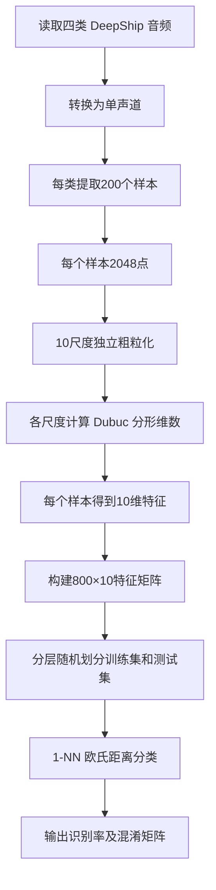
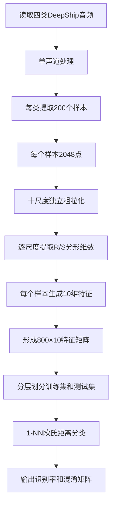
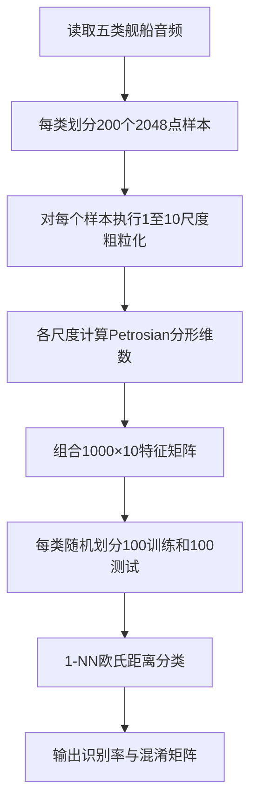
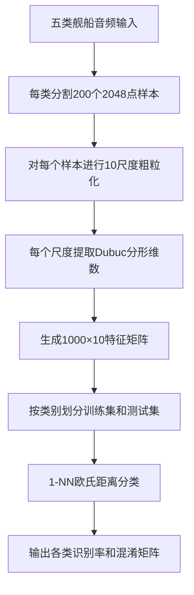
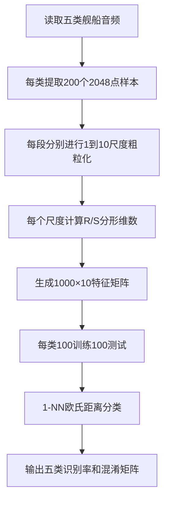

# CI-Higuchi 船舶音频分类 / CI-Higuchi Ship-Audio Classification

## 项目简介 / Project Overview

本项目归档了基于船舶音频信号的 MATLAB 实现，用于研究随机共振预处理、分形维数特征提取和 KNN 分类的组合流程。已实现的特征算法包括置信区间改进 Higuchi（CI-Higuchi）、传统 Higuchi（作为 `ci_hfd.m` 内部对比函数）、Katz 分形维数和计盒维数（FX）。随机共振版本通过四阶 Runge--Kutta（RK4）求解器处理每个音频片段，然后提取一个标量分形维数特征。

本仓库不包含原始音频、提取后的特征、运行日志、指标或性能结论。代码的存在仅表示实现已归档；除非本 README 的状态表明确给出可核验依据，否则不表示实验已执行或验证。

## 项目目录 / Project Structure

```text
.
├── ci_hfd.m                    # 正式主程序：四类、随机共振 + CI-Higuchi + 1-NN
├── ci_hfd_no_sr.m              # 四类对比：不使用随机共振的 CI-Higuchi
├── ci_fd_katz.m                # 四类对比：不使用随机共振的 Katz
├── ci_fd_fx.m                  # 四类对比：不使用随机共振的计盒维数
├── Rung_kutta_JDSR_k.m         # 随机共振版本调用的 RK4 求解器
├── v2/
│   ├── ci_hfd.m                # 五类、随机共振 + CI-Higuchi
│   ├── ci_hfd_no_sr.m          # 五类、10 尺度粗粒化 CI-Higuchi
│   ├── ci_fd_katz.m            # 五类、无随机共振 Katz
│   ├── ci_fd_katz_sr.m         # 五类、随机共振 Katz
│   ├── ci_fd_fx.m              # 五类、10 尺度粗粒化计盒维数
│   └── Rung_kutta_JDSR_k.m     # RK4 副本
├── v3_ds/
│   ├── ds_fx.m                 # 四类、无 SR、10 尺度 FX + 1-NN
│   ├── ds_higuchi.m            # 四类、无 SR、10 尺度 CI-Higuchi + 1-NN
│   └── ds_katz.m               # 四类、无 SR、10 尺度 Katz + 1-NN
├── 对比算法/
│   ├── Katz_FD.m               # Katz 实现（保留文件内原作者署名）
│   └── FX.m                    # 计盒维数实现
├── PARAMETERS.md               # 从源代码提取的参数表
├── EXPERIMENTS.md              # 实验/归档状态说明
└── AGENTS.md                   # 本项目 Git 与 README 长期维护规则
```

## 2026-10-27：v3_ds 十尺度 Petrosian 分类 / 10-Scale Petrosian Classification

新增 `v3_ds/ds_petrosian.m`，使用同目录原有的 `Petrosian_FD.m`。该函数保持原始 Petrosian 定义不变：以一阶差分符号变化数 `N_delta` 计算 `D = log10(N) / (log10(N) + log10(N / (N + 0.4*N_delta)))`；主程序只按其既有单输入、单标量输出接口调用，未修改其公式。

程序优先使用 `v3_ds/DeepShip-main/` 中的四个指定输入：Cargo `27.wav`、Passengership `1.wav`、Tanker `2.wav` 和 Tug `9.wav`。每类通过 `audioread` 读取，多声道按 `mean(x,2)` 转为单声道；从每类信号前部依次截取 200 个不重叠的 2048 点片段，索引为 `idx = (i-1)*2048 + (1:2048)`，长度不足则报错。

每个原始 2048 点片段独立按 `tau=1:10` 做非重叠均值粗粒化，尾部不足一组的点舍弃。因此 10 个尺度长度依次为 2048、1024、682、512、409、341、292、256、227、204；每个粗粒化序列计算一个 Petrosian 分形维数，构成 `800×10` 的 `features`，同时生成 `800×1` 的 `labels`。程序对每个特征检查有限实数；异常会报告类别、样本、尺度及函数调用原因。

分类保持四类既有规则：`rng(42)` 后每类随机选 100 个训练片段，其余 100 个测试；`fitcknn` 使用全部 10 列特征、`NumNeighbors=1` 和欧氏距离。输出 Cargo、Passengership、Tanker、Tug 各类识别率、总体识别率，以及“行=真实类别、列=预测类别”、类别顺序与输入一致的 4×4 混淆矩阵。

```mermaid
flowchart TD
    A[四个指定 DeepShip WAV] --> B[audioread；多声道 mean(x,2)]
    B --> C[每类前 200 个非重叠 2048 点片段]
    C --> D[每片段独立 tau=1:10 非重叠均值粗粒化]
    D --> E[每尺度调用原有 Petrosian_FD]
    E --> F[800x10 特征；800x1 标签]
    F --> G[rng(42)；每类 100 训练和 100 测试]
    G --> H[1-NN；欧氏距离；全部 10 列]
    H --> I[四类和总体识别率；4x4 混淆矩阵]
```

更新时间（UTC+08:00）：2026-10-27 20:34。操作：新增并运行十尺度 Petrosian 分类实验；影响文件：`v3_ds/ds_petrosian.m`、`README.md`；验证状态：`EXECUTED`。输出 `features=800×10`、训练集 `400×10`、测试集 `400×10`；Cargo、Passengership、Tanker、Tug 识别率和总体识别率均为 100.00%，混淆矩阵为 `diag([100,100,100,100])`。该新增流程未调用随机共振、RK4 或相关函数。

## 2026-10-27：10 尺度 Dubuc 分形维数四类舰船声音分类

新增 `v3_ds/ds_dubuc.m`，直接调用同目录原有的 `v3_ds/Dubuc_FD.m`。原始 Dubuc variation 方法及其默认 dyadic radii 规则保持不变；主程序未重写或调整算法公式。该函数的单输入调用会按粗粒化序列长度使用其既有半径逻辑，最短尺度 10 序列为 204 点，满足其 128 点最小输入长度要求。

程序优先使用 `v3_ds/DeepShip-main/`，若该目录不含全部指定 WAV 才回退至 `2_higuchi/DeepShip-main/`。输入严格为 Cargo `27.wav`、Passengership `1.wav`、Tanker `2.wav` 和 Tug `9.wav`；每个 WAV 经 `audioread` 读取，多声道以 `mean(x,2)` 转为单声道。从开头顺序截取每类 200 个连续、不重叠的 2048 点样本，音频过短会明确报错。

每个原始片段独立对 `tau=1:10` 进行非重叠均值粗粒化，不递归使用前一尺度结果。十个粗粒化序列各调用一次原有 Dubuc 算法，组成 `800×10` 特征矩阵和 `800×1` 标签矩阵；特征写入前拒绝非标量、复数或非有限值。随后用 `rng(42)` 对每类作 100/100 训练测试划分，以全部 10 列特征进行 1-NN 欧氏距离分类，并输出特征、训练集、测试集尺寸、各类与总体识别率及 4×4 混淆矩阵。



更新时间（UTC+08:00）：2026-10-27。代码变更：新增 `v3_ds/ds_dubuc.m`，README 增补实验记录与流程图；未修改 `Dubuc_FD.m` 或其他算法实验。已静态核对数据路径、四个指定音频、2048 点分段、十个外部粗粒化尺度、原函数调用、`800×10` 特征写入、10 列 KNN 输入及无随机共振调用。本机未发现 MATLAB 可执行文件，故未实际运行完整分类，也未填写识别率或混淆矩阵结果。

## 2026-10-27：新增十尺度 R/S 分形维数舰船声音分类实验

新增 `v3_ds/ds_rs.m`，直接调用同目录原有 `v3_ds/RS_FD.m` 的单输入接口。该函数以非重叠窗口的 R/S（rescaled range）均值进行对数回归，先得到 Hurst 指数 `H`，再按其明确限定的自仿射图形定义返回分形维数 `D = 2-H`；本实验使用函数直接输出的 `D`，未自行转换、重写或修改其公式。默认内部窗口为从 8 到 `floor(N/4)` 的 2 的幂；最短的 204 点外部粗粒化序列使用 `[8,16,32]`，满足原函数至少三个窗口尺度的要求。

输入严格为 DeepShip 的 Cargo `27.wav`、Passengership `1.wav`、Tanker `2.wav` 和 Tug `9.wav`。程序优先使用 `v3_ds/DeepShip-main/`，否则检查 `2_higuchi/DeepShip-main/`；以 `audioread` 读取并在必要时用 `mean(x,2)` 转单声道。每类从开头顺序提取 200 个连续、不重叠的 2048 点样本，长度不足会明确报错。

每个原始样本直接独立按 `tau=1:10` 进行非重叠均值粗粒化，各尺度调用一次 `RS_FD`，得到 10 个 R/S 分形维数。程序构建 `800×10` 特征矩阵与 `800×1` 标签矩阵；使用 `rng(42)` 后按每类 100 个训练、100 个测试划分，以全部 10 列特征进行 1-NN 欧氏距离分类，并输出四类、总体识别率和行=真实标签、列=预测标签的 4×4 混淆矩阵。未加入特征标准化、PCA、权重或其他分类器。



更新时间（UTC+08:00）：2026-10-27。代码变更：新增 `v3_ds/ds_rs.m`，并同步修订 `v3_ds/RS_FD.m` 与 `v2/RS_FD.m` 的零方差块处理：R/S 对 `S=0` 的块无定义，函数现仅平均同一窗口尺度内 `S>0` 的有效块；若该尺度没有有效块，仍明确报错。外部粗粒化、内部窗口尺度、R/S 回归、`D=2-H`、特征维度及分类设置均未改变。已完成静态接口、窗口兼容性、十尺度、特征矩阵、二维 KNN 索引及无随机共振调用检查。本次未重新运行 MATLAB、Octave、音频读取、特征计算、训练或分类，因此未记录新的识别率与混淆矩阵结果。

未纳入公开版本控制的本地目录包括 `DeepShip-main/`、`v2/音频/`、`backup/`、`OG/` 和 `材料/`。其中前两者含原始或本地音频；`backup/` 与 `OG/` 是历史副本，不是正式入口或独立实验版本。

## 程序流程图 / Program Workflow

根目录四类脚本使用代码中写死的相对 WAV 路径；`v2` 脚本在五个类别目录中递归寻找且要求恰有一个受支持音频文件。两类脚本均先调用 `audioread`，多声道则按列均值转单声道，检查每类至少有 `200 × 2048` 个采样点，再按类别循环切分前 200 个非重叠片段。

```mermaid
flowchart TD
    S[选择根目录四类脚本或 v2 五类脚本] --> I{输入文件定位}
    I -->|根目录四类| R1[固定相对 WAV 路径]
    I -->|v2 五类| R2[FindSupportedAudioFile<br/>每类目录必须恰有一个受支持音频]
    R1 --> A[audioread]
    R2 --> A
    A --> M{多声道?}
    M -->|是| MONO[mean(x, 2) 转为单声道]
    M -->|否| LEN[保持原信号]
    MONO --> LEN[检查每类长度至少 200 x 2048]
    LEN --> SEG[按类循环 200 次<br/>截取非重叠 2048 点片段]
    SEG --> ALG{所选特征版本}
    ALG -->|CI-Higuchi + SR| SR[RK4: Rung_kutta_JDSR_k(a,b,h,x)]
    SR --> Z[按均值和标准差标准化]
    Z --> CI[CI_Higuchi<br/>kmax=20, alpha=0.95]
    ALG -->|v2 CI-Higuchi 多尺度| CGH[每个片段独立作 tau=1:10<br/>非重叠均值粗粒化]
    CGH --> HLEN[长度 2048, 1024, 682, 512, 409,<br/>341, 292, 256, 227, 204]
    HLEN --> CI0[每尺度 CI_Higuchi<br/>kmax=20, alpha=0.95]
    ALG -->|Katz + SR，仅 v2| KSR[RK4 后标准化]
    KSR --> K[Katz_FD 行向量]
    ALG -->|Katz 无 SR| K0[Katz_FD 行向量]
    ALG -->|v2 FX 多尺度| CGF[每个片段独立作 tau=1:10<br/>非重叠均值粗粒化]
    CGF --> FXLEN[截取不超过当前长度的<br/>最大 2 的整数次幂]
    FXLEN --> FX[FX(x_fx, cellmax)<br/>cellmax=length(x_fx)]
    CI --> F[原版本：每片段一个标量特征<br/>v2 多尺度：每片段 10 维特征<br/>并写入类别标签]
    CI0 --> F
    K --> F
    K0 --> F
    FX --> F
    F --> SPLIT[rng(42)<br/>每类随机选 100/200 片段训练]
    SPLIT --> KNN[fitcknn: 1 邻居、欧氏距离]
    KNN --> OUT[predict<br/>输出各类/总体识别率和混淆矩阵]
```

分支差异完全来自当前代码：根目录含四类 CI-Higuchi（有/无随机共振）、Katz（无随机共振）和 FX（无随机共振）；`v2` 扩展为五类，并额外含 `ci_fd_katz_sr.m`。所有脚本将结果显示在 MATLAB 命令窗口和工作区；代码没有写出结果文件的语句。

### v3_ds 十尺度流程 / v3_ds 10-Scale Workflow

`v3_ds` 的三个脚本以其现有代码为准，处理四类音频（Cargo、Passengership、Tanker、Tug），而非五类。每类读取指定 WAV、多声道按 `mean(x,2)` 转单声道，并从前 `200 × 2048` 个采样点切出 200 个连续且不重叠的片段。对每个独立的 2048 点原始片段，直接生成 `tau=1:10` 的非重叠分组均值序列：尺度 `tau` 的长度为 `floor(2048/tau)`；尾部不足一组的点被舍弃。各尺度均从同一原始片段生成，绝不递归粗粒化、跨片段或跨类别混合。

```mermaid
flowchart TD
    A[四类原始舰船音频] --> B[原有预处理: audioread; 多声道 mean(x,2)]
    B --> C[原有分段: 每类前 200 个不重叠 2048 点片段]
    C --> D[每个片段独立进行 tau=1:10 非重叠分组均值]
    D --> E{选择一个 v3_ds 算法}
    E --> F[FX: 10 个 FX 特征]
    E --> G[CI-Higuchi: 10 个 HFD 特征]
    E --> H[Katz: 10 个 Katz 特征]
    F --> I[每片段一个 10 维特征向量]
    G --> I
    H --> I
    I --> J[组装 800x10 特征矩阵和 800x1 标签]
    J --> K[原有划分: rng(42), 每类 100 训练 / 100 测试]
    K --> L[原有 KNN: 1 邻居, 欧氏距离]
    L --> M[输出四类识别率、总体识别率和混淆矩阵]
```

## 算法与参数 / Algorithms & Parameters

| 项目 | 实际设置与含义 | 源代码入口 |
|---|---|---|
| CI-Higuchi | `kmax=20`，计算内部尺度 `1:20`；`alpha=0.95`，用于按 t 分布置信区间剔除正长度序列中的离群值。`v2/ci_hfd_no_sr.m` 另对每个片段按外部粗粒化尺度 `tau=1:10` 提取 10 个特征；`kmax` 不是粗粒化尺度数。 | `ci_hfd.m`、`ci_hfd_no_sr.m`、`v2/ci_hfd.m`、`v2/ci_hfd_no_sr.m` |
| 传统 Higuchi | `Traditional_Higuchi(x,kmax)` 定义在 CI-Higuchi 脚本中；当前主流程不将其写入分类特征 | 同上 |
| 随机共振与 RK4 | `a=10`、`b=1`、`h=0.01`；RK4 迭代项为 `a*x - b*x^3 + input`，初始输出向量为零 | `ci_hfd.m`、`v2/ci_hfd.m`、`v2/ci_fd_katz_sr.m`、`Rung_kutta_JDSR_k.m` |
| Katz | 调用前转为行向量；`Katz_FD.m` 没有生效的 `Kmax` 参数 | `ci_fd_katz.m`、`v2/ci_fd_katz*.m`、`对比算法/Katz_FD.m` |
| 计盒维数 | `FX(x,cellmax)` 要求 `cellmax` 不小于输入长度；其网格循环还以 `log2(cellmax)` 作为层数。`v2/ci_fd_fx.m` 因而在每个尺度的粗粒化后，截取不超过当前长度的最大 2 的整数次幂，并令 `cellmax` 等于该截取长度。尺度 1 保持原始 2048 点和 `cellmax=2048`。 | `ci_fd_fx.m`、`v2/ci_fd_fx.m`、`对比算法/FX.m` |
| 音频预处理 | `audioread`；多声道 `mean(x,2)`；未重采样，采样率由 `~` 接收且未参与后续计算 | 所有分类脚本 |
| 分段与特征 | 每类前 200 个连续、不重叠的 2048 点片段。`v2/ci_fd_fx.m` 与 `v2/ci_hfd_no_sr.m` 对每个独立片段按 `y_tau(j)=mean(x((j-1)*tau+1:j*tau))`（`tau=1:10`）提取 10 维特征，尾部不足一个窗口的点舍弃；不跨片段平均。两者的特征矩阵均为 `1000×10`（5×200），标签仍为 `1000×1`。 | `v2/ci_fd_fx.m`、`v2/ci_hfd_no_sr.m` |
| 分类器 | `rng(42)`；每类随机选 100 个片段训练、其余 100 个测试；`fitcknn(...,'NumNeighbors',1,'Distance','euclidean')` | 所有分类脚本 |

完整的逐项参数索引见 [PARAMETERS.md](PARAMETERS.md)。代码的片段级划分会使同一源录音的片段同时进入训练和测试；它不是源文件级独立评估的声明。

`v3_ds` 的三种算法均保持各自原有数学定义与参数不变：FX 仍调用 `对比算法/FX.m`，CI-Higuchi 仍为 `kmax=20`、`alpha=0.95` 并保留原有置信区间异常值处理，Katz 仍调用 `对比算法/Katz_FD.m` 的原有曲线长度和直径计算。每个 v3 脚本现在产生 `800×10` 特征矩阵和 `800×1` 标签；列依次对应尺度 1 至 10。KNN 的随机种子、每类 100/100 划分、1 邻居、欧氏距离、标签和准确率计算均未改变。v3 的实际信号处理链没有调用 `Rung_kutta_JDSR_k`、双稳态随机共振函数或其数值积分参数。

FX 的 `cellmax` 为每个粗粒化序列选择不小于其长度的最小 2 的幂：尺度 1 仍为 2048，保持修改前的调用；其余尺度避免将不合法的固定 2048 误用于不同长度，同时满足该实现的网格层级约束。三种脚本均在写入特征前检查结果是否为有限实数；异常会报告类别、样本和尺度，不以填充值或删样本掩盖问题。

`v2/ci_fd_katz.m` 与 `v2/ci_fd_katz_sr.m` 实际构造的查找路径仍是 `v2/对比算法`，而归档实现位于仓库根目录 `对比算法/`。本次已将 `v2/ci_fd_fx.m` 修正为根目录的实际 FX 路径；其余历史脚本未修改。

## 已完成的操作 / Completed Work

状态含义：`IMPLEMENTED`=实现存在；`EXECUTED`=有可核验运行记录；`VERIFIED`=有可核验验证结果；`PENDING`=尚待执行或验证；`ABORTED`=已中止；`SUPERSEDED`=被替代。当前 Git 历史仅含本地代码归档提交，未含 MATLAB 运行记录或实验结果。

| 项目 | 状态 | 可核验依据与边界 |
|---|---|---|
| 四类 CI-Higuchi、随机共振、RK4、KNN 实现 | `IMPLEMENTED`; `PENDING`（执行/验证） | 入口 `ci_hfd.m` 与 `Rung_kutta_JDSR_k.m` 已跟踪；没有提交的运行输出或结果文件。 |
| 四类无 SR、Katz、FX 对比实现 | `IMPLEMENTED`; `PENDING`（执行/验证） | `ci_hfd_no_sr.m`、`ci_fd_katz.m`、`ci_fd_fx.m` 已跟踪；没有可核验运行记录。 |
| 五类 `v2` 10 尺度粗粒化 CI-Higuchi 与 FX | `IMPLEMENTED`; `EXECUTED`; `VERIFIED`（本次） | `v2/ci_hfd_no_sr.m` 和 `v2/ci_fd_fx.m` 均用本地五类音频执行完成。保持每类 200 段、`rng(42)`、每类 100/100 训练测试划分、1-NN 欧氏距离和标签规则。CI-Higuchi 总体识别率为 77.20%，FX 为 79.80%。 |
| 四类 `v3_ds` 十尺度 FX、CI-Higuchi、Katz | `IMPLEMENTED`; `PENDING`（完整 MATLAB 分类） | 静态检查确认每个 2048 点片段以 `tau=1:10` 直接生成 10 个非重叠均值粗粒化序列；三个脚本均为 `800×10` 特征和原有 `800×1` 标签。v3 目录未提供其脚本所期望的本地 `DeepShip-main/` 音频目录，故未伪造运行结果。 |
| 性能指标、分类结果和结果文件 | `PENDING` | 仓库明确排除原始数据与结果，不编造准确率或性能。 |
| `backup/`、`OG/` 历史副本 | `SUPERSEDED`（归档边界） | 已在 `.gitignore` 排除；不是公开主线或独立实验。 |
| 已中止实验 | 无可核验条目 | 当前 Git 历史、公开文档和已跟踪代码中未发现可据实标记为 `ABORTED` 的记录。 |

## 运行与复现 / Reproduction

1. 使用 MATLAB，并确保可用 `audioread`、`tinv`、`fitcknn` 和 `confusionmat`（通常需要 Statistics and Machine Learning Toolbox）。
2. 仅使用你有权使用的音频。根目录四类脚本需要代码所列的 `DeepShip-main/<类别>/<文件>.wav` 相对路径；`v2` 需要五个 `v2/音频/<类别>/` 目录，并且每个目录递归后恰有一个受支持音频文件。
3. 确保每类音频至少含 `200×2048` 个采样点；脚本不会重采样，且不使用采样率变量。两个已更新的 `v2` 脚本将每段独立按 `tau=1:10` 粗粒化；Higuchi 在最短的 204 点尺度 10 输入上仍以 `kmax=20` 计算，FX 则使用 2048、1024、512、512、256、256、256、256、128、128 点截取及同值 `cellmax`。
4. 选择一个入口：`ci_hfd.m` 为根目录随机共振 CI-Higuchi 主程序；其余脚本是上表所列对比版本。不要把多个脚本的工作区结果混作同一次实验。
5. 执行前核对参数表和 `v2` 对比算法路径说明。执行后，当前脚本只在命令窗口显示识别率/混淆矩阵，并在工作区保留变量；不自动生成结果文件。

2026-10-27 的多尺度更新已实际运行 MATLAB。两条执行路径都直接从音频片段进行粗粒化与特征提取，未调用 `Rung_kutta_JDSR_k` 或其他随机共振求解函数，也未保留随机共振参数。MATLAB `checkcode` 未报告错误（仅有原有未调用 `Traditional_Higuchi` 的提示）；运行时逐特征拒绝非有限或复数值。FX 运行中记录到原始 `FX.m` 的若干 `polyfit` 秩亏警告，但程序完成且未有 NaN/Inf 进入 KNN。

## 更新日志 / Development Changelog

| 更新时间（UTC+08:00） | 操作类型 | 更新内容 | 影响文件 | 状态 |
|---|---|---|---|---|
| 2026-10-27 22:43 | chore / docs | 首次本地归档前审计：归档已确认的 R/S 零方差块处理修订及其现有文档说明；未包含未确认的脚本删除、本地原始音频、实验草稿或下载目录。 | `v2/RS_FD.m`, `README.md` | 已完成（仅本地归档） |
| 2026-10-27 21:46 | feat / docs | 新增五类 10 尺度 R/S 分形维数分类入口。每片段独立按 `tau=1:10` 非重叠均值粗粒化并形成 `1000×10` 特征，保持 `rng(42)`、每类 100/100 划分和 1-NN 欧氏距离。静态检查确认直接调用 `RS_FD.m` 的 `D=2-H` 标量输出、最短 204 点输入兼容且调用链不含随机共振；本次未运行 MATLAB。 | `v2/ci_fd_rs_multiscale10.m`, `v2/RS_FD.m`, `README.md` | 已完成（代码与静态检查）；运行待验证 |
| 2026-10-27 21:10 | feat / docs | 新增五类舰船声音的 10 尺度 Dubuc 分形维数分类入口；每片段独立按 `tau=1:10` 非重叠均值粗粒化并形成 `1000×10` 特征，保留 `rng(42)`、每类 100/100 划分和 1-NN 欧氏距离。MATLAB `checkcode` 与完整运行均成功，未出现无效特征；总体识别率为 98.80%。 | `v2/ci_fd_dubuc_multiscale10.m`, `v2/Dubuc_FD.m`, `README.md` | 已完成（实现、静态检查与运行验证） |
| 2026-10-27 20:33 | feat / docs | 新增五类舰船声音的 10 尺度 Petrosian 分形维数分类入口。每个 2048 点片段独立作 `tau=1:10` 非重叠均值粗粒化，组合为 `1000×10` 特征；保留 `rng(42)`、每类 100/100 划分及 1-NN 欧氏距离。静态检查确认直接调用原有 `Petrosian_FD.m`、输入可为行/列向量、特征有限实数检查带类别/样本/尺度上下文，且调用链不含随机共振。MATLAB 完整实验未运行，未记录识别率。 | `v2/ci_fd_petrosian_multiscale10.m`, `v2/Petrosian_FD.m`, `README.md` | 已完成（实现与静态检查）；完整实验待验证 |
| 2026-10-27 19:52 | feat | 将 `v3_ds/ds_fx.m`、`v3_ds/ds_higuchi.m`、`v3_ds/ds_katz.m` 改为每片段 `tau=1:10` 非重叠均值粗粒化后的 10 维同算法分形特征；保留原有四类音频路径、2048 点分段、KNN 参数与准确率输出。FX 对每尺度按最小兼容 2 的幂设置 `cellmax`，尺度 1 仍为 2048；增加有限值检查。静态检查通过；由于 v3 本地音频路径缺失，未执行 MATLAB 完整分类，未填写准确率前后对比。本次 Git 提交信息：`feat: add 10-scale coarse-grained FD features to ds classifiers`。 | `v3_ds/ds_fx.m`, `v3_ds/ds_higuchi.m`, `v3_ds/ds_katz.m`, `README.md` | 已完成（实现与静态检查）；完整实验待验证 |
| 2026-10-27 19:51 | feat / docs | `v2/ci_fd_fx.m` 与 `v2/ci_hfd_no_sr.m` 均改为对每个 2048 点片段作 `tau=1:10` 非重叠均值粗粒化，并生成 `1000×10` 特征矩阵；FX 按每尺度最大 2 次幂截取同步设置 `cellmax`，CI-Higuchi 保持 `kmax=20`。修正五类 FX 脚本至根目录 `对比算法/FX.m` 的实际路径。完成 MATLAB 静态检查及实际运行：FX 79.80%，CI-Higuchi 77.20%；FX 有原函数 `polyfit` 秩亏警告，未产生非有限特征。 | `v2/ci_fd_fx.m`, `v2/ci_hfd_no_sr.m`, `README.md` | 已完成（实现、静态检查与运行验证） |
| 2026-10-27 15:59 | docs | 建立持续维护的 GitHub 首页：基于已跟踪 MATLAB 源码补充真实目录、Mermaid 数据流、参数、复现边界、实验状态与 Git 更新日志；新增项目维护规则。未运行实验。 | `README.md`, `AGENTS.md` | 已完成（文档）；实验待验证 |
| 2026-10-27 15:49 | docs | 创建公开代码归档、参数/实验说明与排除规则；该时间来自 commit `c363805`。 | `.gitignore`, `README.md`, `PARAMETERS.md`, `EXPERIMENTS.md`, MATLAB 源文件 | 已完成（本地归档）；远端备份待验证 |

## 本次 v2 多尺度更新 / v2 Multiscale Update

2026-10-27 19:51（UTC+08:00）实际修改 `v2/ci_fd_fx.m` 和 `v2/ci_hfd_no_sr.m`：每个独立的 2048 点片段均按 `tau=1:10` 作非重叠均值粗粒化，`y_tau(j)=mean(x((j-1)*tau+1:j*tau))`，尾部不足一个窗口的点舍弃。每片段由 1 维分形特征变为 10 维，五类共 1000 个样本的 `features` 为 `1000×10`，标签仍为 `1000×1`。

FX 使用原有 `FX.m`：尺度 1 仍直接传入原始 2048 点并使用 `cellmax=2048`；其他尺度使用不超过粗粒化长度的最大 2 的整数次幂截取，并同步设置 `cellmax`。CI-Higuchi 保持原有 `kmax=20`（算法内部参数，而非粗粒化尺度数）和 `alpha=0.95`。两条路径均保持 `rng(42)`、每类 100/100 训练测试划分、1-NN 和欧氏距离；未调用随机共振求解函数或参数。

MATLAB `checkcode` 未报告错误（仅有原有未调用 `Traditional_Higuchi` 的提示）。两条程序均完成实际运行，且逐特征有限实数检查未报错：FX 总体识别率 79.80%，CI-Higuchi 总体识别率 77.20%。FX 运行时有原始 `FX.m` 的 `polyfit` 秩亏警告；程序未产生 NaN/Inf 并完成 KNN 分类。

```mermaid
flowchart TD
    A[五类音频] --> B[audioread；多声道 mean(x,2)]
    B --> C[每类前 200 个不重叠 2048 点片段]
    C --> D[每个片段独立进行 tau=1:10 非重叠均值粗粒化]
    D --> E{算法}
    E --> F[FX：截取最大 2 的幂并同步 cellmax]
    E --> G[CI-Higuchi：每尺度 kmax=20]
    F --> H[1000x10 特征与 1000x1 标签]
    G --> H
    H --> I[rng(42)；每类 100 训练 / 100 测试]
    I --> J[1-NN；欧氏距离；识别率和混淆矩阵]
```

## 新增实验：10 尺度 Petrosian 分形维数舰船声音分类

入口为 `v2/ci_fd_petrosian_multiscale10.m`，依赖同目录的 `v2/Petrosian_FD.m`。后者是原有 Petrosian 分形维数实现：将任意实数向量转换为列向量，以一阶差分符号变化次数 `N_delta` 计算单个标量维数；本实验未修改该算法文件的数学定义。

输入为五类音频：国家渡轮、货轮、螺旋桨呜呜呜、舷外发动机发出呜呜声和加速、游轮。每类通过 `FindSupportedAudioFile` 递归定位唯一的受支持音频；多声道按 `mean(x,2)` 转为单声道，再从前 `200×2048` 点按连续、不重叠方式取得 200 段。

每个独立的 2048 点片段直接生成尺度 `tau=1:10` 的非重叠均值粗粒化序列，长度为 `floor(2048/tau)`，尾部不足一组的点舍弃。十个尺度各调用一次 `Petrosian_FD`，形成 `[PFD_1,...,PFD_10]`；五类共组装为 `1000×10` 特征矩阵和 `1000×1` 标签。特征提取会拒绝 NaN、Inf 或复数，并报告类别、样本和尺度。

分类规则保持不变：`rng(42)`，每类随机选 100 段训练、其余 100 段测试，`fitcknn(...,'NumNeighbors',1,'Distance','euclidean')`；输出五类识别率、总体识别率与行=真实标签、列=预测标签的 `5×5` 混淆矩阵。该路径没有随机共振处理、随机共振参数或相关求解流程。



## 10 尺度 Dubuc 分形维数舰船声音分类实验

入口为 `v2/ci_fd_dubuc_multiscale10.m`，直接调用同目录原有的 `v2/Dubuc_FD.m`。Dubuc 函数接受实数、有限的一维行/列时间序列；本实验按其默认内部半径规则完成对数拟合，每个调用返回一个 Dubuc 分形维数标量，未调整其数学公式、内部半径或拟合规则。

输入为五类舰船音频：国家渡轮、货轮、螺旋桨呜呜呜、舷外发动机发出呜呜声和加速、游轮。每类递归定位唯一受支持音频，多声道按 `mean(x,2)` 转为单声道，并从前 `200×2048` 个采样点分割出 200 个连续、不重叠的样本。

每个 2048 点样本独立按 `tau=1:10` 进行非重叠均值粗粒化：`y_tau(j)=mean(x((j-1)*tau+1:j*tau))`，长度为 `floor(2048/tau)`，尾部不足一个窗口的点舍弃。十个尺度均直接由原始样本计算，各尺度各提取一个 Dubuc 分形维数，形成 `1000×10` 特征矩阵及 `1000×1` 标签。

分类保持 `rng(42)`、每类随机 100 训练 / 100 测试，`fitcknn(...,'NumNeighbors',1,'Distance','euclidean')`；不进行标准化、PCA 或特征筛选。程序输出无效特征状态、五类识别率、总体识别率及行=真实标签、列=预测标签的 `5×5` 混淆矩阵。



## 10 尺度 R/S 分形维数舰船声音分类实验

入口为 `v2/ci_fd_rs_multiscale10.m`，直接调用同目录的原有 `v2/RS_FD.m`。该函数接受有限实数行/列向量，以非重叠窗口的重标极差（R/S）均值作对数回归估计 Hurst 指数 `H`，并返回原算法定义的分形维数标量 `D = 2 - H`；本实验未调整其公式、窗口规则或参数。最短的尺度 10 序列为 204 点，使用默认内部窗口 `[8,16,32]`，满足其至少三个窗口尺度及 128 点最短输入要求。

五类音频为国家渡轮、货轮、螺旋桨呜呜呜、舷外发动机发出呜呜声和加速、游轮。每类递归定位唯一受支持音频，多声道按 `mean(x,2)` 转单声道，并从前 `200×2048` 个采样点得到 200 个连续、不重叠的样本。

每个样本独立按 `tau=1:10` 进行非重叠均值粗粒化：`y_tau(j)=mean(x((j-1)*tau+1:j*tau))`，长度为 `floor(2048/tau)`，尾部不足完整窗口的采样点舍弃。十个尺度均直接由原始样本生成，各提取一个 R/S 分形维数，形成 `1000×10` 特征矩阵和 `1000×1` 标签。分类固定为 `rng(42)`、每类 100 训练 / 100 测试与 1-NN 欧氏距离，未包含标准化、PCA、特征筛选或加权。



更新记录：2026-10-27 21:46（UTC+08:00）创建 `v2/ci_fd_rs_multiscale10.m`，接入原有 `v2/RS_FD.m`，实现十尺度独立粗粒化与 `1000×10` 特征构建。已完成代码文本、函数接口、最短输入窗口兼容性、特征有效性防护、KNN 参数及直接调用链检查；本次明确未运行 MATLAB、音频读取、特征计算、训练或分类，未产生识别率或混淆矩阵。

## 2026-10-27：四种分形维数程序新增三类舰船声音

本次直接修改 `v2/ci_fd_fx.m`、`v2/ci_fd_katz_multiscale10.m`、`v2/ci_fd_rs_multiscale10.m` 和 `v2/ci_hfd_no_sr.m`。四个程序均保留原有五类及其顺序，并在末尾追加以下三个独立类别：

- `舷外发动机60马力10节`：`v2/音频/舷外发动机（60马力）在10节/705da20f-b986-4e49-ae58-39f9f286e9ad.mp3`
- `舷外发动机60马力20节`：`v2/音频/舷外发动机（60马力）在20节/39f7562b-1d7a-4fe4-a969-6be98e7d4886.mp3`
- `小型柴油发动机船只`：`v2/音频/由小型柴油发动机驱动的过往船只的水下记录/cb678cb6-5627-4544-9fbb-c8e3884f0827.mp3`

四个入口均由 5 类扩展为 8 类：每类仍使用 200 个连续、不重叠的 2048 点样本，使用既有 `audioread` 和原有多声道平均规则；总特征行数与标签行数均为 `1600`。FX、10 尺度 Katz、10 尺度 R/S 和 CI-Higuchi 分别保持各自原有算法；四条路径的既有 10 尺度特征流程未改，单个样本仍为 10 维。`rng(42)`、每类 100/100 训练测试划分、1 邻居欧氏距离 KNN、准确率输出和 8×8 混淆矩阵逻辑均保持不变；未加入随机共振。

```mermaid
flowchart TD
    A[原有五类音频] --> C[八类音频：末尾追加三段 MP3]
    B[三段新增 MP3] --> C
    C --> D[audioread 与原有声道处理]
    D --> E[每类 200 个连续不重叠的 2048 点样本]
    E --> F[保留各入口既有的 10 尺度分形维数特征]
    F --> G[1600×10 特征矩阵与 1600×1 标签]
    G --> H[rng(42)：每类 100 训练 / 100 测试]
    H --> I[原有 1-NN 欧氏距离 KNN]
    I --> J[8 类统计与 8×8 混淆矩阵]
```

本次本地归档记录：2026-10-27 22:43（UTC+08:00）先完成既有确认改动的本地检查点提交 `40c100d`；2026-10-27 22:59（UTC+08:00）完成上述四个入口和本 README 的第二次本地归档。仅进行了文本、路径存在性、Git diff 和结构一致性静态检查；未运行 MATLAB、Octave、音频读取、特征提取、KNN、混淆矩阵或任何分类实验，故不包含实验结果。


